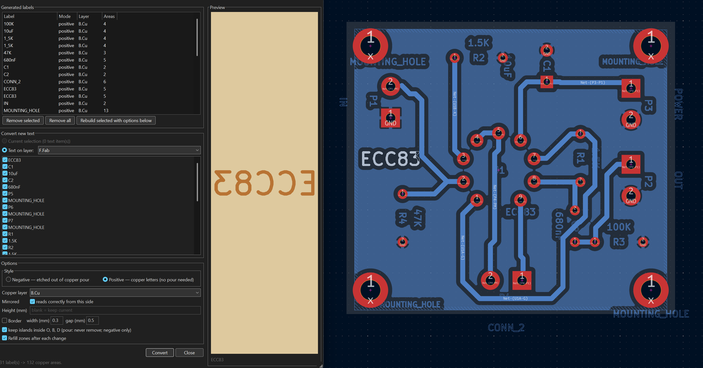

# Copper text for KiCad (negative / positive)

A KiCad 10 action plugin that turns text into copper artwork, for home-etched
boards:

- **Negative**: etches text *out* of a copper pour. The pour floods solid and
  the letters read as bare substrate. Positive copper text costs clearance from
  every nearby track and pad, and can pinch a pour badly enough to orphan a pad;
  negative text costs none.
- **Positive**: builds the letters *as* copper, for boards with no ground plane
  to knock text out of.

Either mode can add a rectangular **border** around the label. Every label
stays editable: change the source text and press Rebuild, or Remove it to get
the original text back.



## Install

The plugin folder must be named `negative_text` (a hyphen is not a valid Python
package name). Clone the repo, then link it into KiCad's plugin folder so the
checkout stays editable in place:

```sh
git clone https://github.com/theriseandfallofitall/kicad-negative-text.git
```

**Linux** (distro or AppImage):

```sh
ln -sfn "$PWD/kicad-negative-text" ~/.local/share/kicad/10.0/scripting/plugins/negative_text
```

**Linux** (flatpak):

```sh
ln -sfn "$PWD/kicad-negative-text" ~/.var/app/org.kicad.KiCad/data/kicad/10.0/scripting/plugins/negative_text
```

**Windows** (Command Prompt; a junction needs no admin rights):

```bat
mklink /J "%APPDATA%\kicad\10.0\scripting\plugins\negative_text" "%CD%\kicad-negative-text"
```

**macOS**:

```sh
ln -sfn "$PWD/kicad-negative-text" ~/Documents/KiCad/10.0/scripting/plugins/negative_text
```

If you don't use git, download the zip from GitHub and extract it into the
same plugins folder as a folder named `negative_text`.

Then in pcbnew: **Tools → External Plugins → Refresh Plugins**.

Written against KiCad 10 (tested on 10.0.5). It uses `SHAPE_POLY_SET`, `ZONE`
rule areas and `PCB_GROUP`, so KiCad 7 or later is the rough floor, but only 10
has been exercised.

## Quick start

1. Put the text you want on a layer, for example F.Fab, or select it in
   pcbnew.
2. **Tools → External Plugins → Copper text**.
3. Pick **Negative** or **Positive**, the target copper layer, and
   optionally a height and border. The preview on the right shows the result
   live.
4. Press **Convert**.

Negative text only shows where a pour fills around it. Full guide: every
control, moving and removing labels, and the DRC warnings to expect:
[docs/usage.md](docs/usage.md).

## Docs

| Doc | Read it for |
|---|---|
| [docs/usage.md](docs/usage.md) | The dialog, every option, moving and removing labels, expected DRC, limits |
| [docs/implementation-notes.md](docs/implementation-notes.md) | pcbnew API behaviour the code works around, for anyone editing it |
| [CLAUDE.md](CLAUDE.md) | Repo layout rules, for contributors |
| [docs/moves.md](docs/moves.md) | Log of moved or renamed files |

## Repo map

| Path | What it is |
|---|---|
| `__init__.py` | Plugin package entry; KiCad imports the repo root as the package |
| `action_negative_text.py` | The toolbar action and the dialog (wx) |
| `negative_text.py` | The core: glyph outlines, zone building, convert/revert |
| `docs/` | User guide and implementation notes; screenshots in `docs/images/` |
| `.githooks/` | Pre-commit layout check (`.githooks/layout_check.py`, settings in `.layout.json`) |

Contributors: turn the layout check on once per clone with
`git config core.hooksPath .githooks`.

## License

MIT, see [LICENSE](LICENSE).
