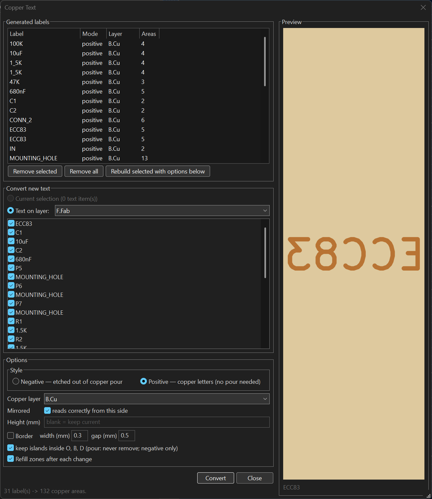

# Using Copper text

## Modes

- **Negative**: etches text *out* of a copper pour. Each glyph becomes a zone
  rule area that forbids copper fill, so the pour floods solid and the letters
  read as bare substrate. Built for home etching, where positive copper text
  costs clearance from every nearby track and pad, and can pinch a pour badly
  enough to orphan a pad.
- **Positive**: builds the letters *as* copper. Each glyph becomes a small
  filled zone with no net. For boards without a ground plane, where there is
  nothing to knock text out of; the stroke font comes out as ordinary
  single-line lettering.

Either mode can add a rectangular **border** frame around the label, with the
frame width and the gap to the text configurable. The frame is the same kind of
area as the glyphs: etched in negative mode, copper in positive.

## The dialog

Tools → External Plugins → **Copper text**. No selection is needed; the dialog
opens either way.

The dialog has three parts:

1. **Generated labels**: every label this plugin has already built on the
   board, listed with its mode, layer and area count. Select rows to
   **Remove** them (areas deleted, source text restored to its original
   layer), or **Rebuild** them with the options currently set below.
2. **Convert new text**: the source. Either the text items selected in pcbnew
   before opening the dialog, or all text on a chosen layer (F.Fab by default),
   with a checkbox per item.
3. **Options**: style (negative/positive), target copper layer, mirroring,
   height, border, counters, refill.

The **preview** pane on the right renders the highlighted label as it would
etch: a copper field with substrate letters in negative mode, the inverse in
positive. Click a row in Generated labels, or a text in the layer list, to
preview it. It follows every option live (style, height, mirror, border width
and gap). The preview changes nothing on the board: adjustments are applied to
a text temporarily, rendered, and restored. The dialog is resizable; the lists
and preview grow with the window.

Selection works **both ways**. Picking a label in the dialog highlights it in
the board editor: the source text and its generated areas brighten and the
canvas pans to them. Clicking one of the plugin's texts, zones or groups in the
editor selects the matching row in the dialog and updates the preview. To make
that possible the dialog is modeless: it stays open beside the editor
(re-running the plugin raises the existing window), and it polls the editor
selection twice a second. The highlight clears when another label is picked or
the dialog closes.

**Remove all** reverts every generated label on the board in one click.

Long operations show **progress**: converts and removes step through the labels
one at a time in a progress dialog, and the zone refill (the slow part on a
dense board) runs under KiCad's own fill progress reporter instead of freezing
the window.

## Options

**Mirrored** is on by default for back layers, so the text reads correctly when
the board is viewed from that side. Front-layer text stays unmirrored: mirror at
plot time for toner transfer, not in the design.

**Height** is blank by default, which keeps each label's current size. Negative
text costs no clearance, so a larger height costs you nothing and is easier to
read. At 0.85 mm with a 0.25 mm stroke, the counters of `B`, `D` and `O` close
up and words turn to blobs; 1.6 mm is comfortable.

**Border** draws a rectangular frame around the label's bounding box. Width is
the frame's line thickness and gap is the space between the text and the
frame's inner edge, both in mm.

**Letter counters** (negative mode) keeps the islands inside `O`, `B`, `D` and
`R`. Those islands are copper connected to nothing, so the pour's default island
removal deletes them and the letters fill in solid. The option sets the pour's
island removal to Never. That changes the whole pour, not just the labels: it
is harmless for etching, but it also keeps any other isolated island, and
**Remove does not undo it**. Positive-mode glyph zones carry the setting
themselves and need no change to the pour.

## Moving labels afterwards

The glyph zones are collected into a group named
`NEGTEXT_<uuid>_L<layer>_<label>` (`POSTEXT_...` for positive), so they select
and move as one object. The `L<layer>` token records where the source text
originally lived, so Remove can put it back.

Source text that sat on a copper layer is kept and moved to the matching Fab
layer (`F.Cu` → `F.Fab`). Text that already lived off copper (on F.Fab, for
example) stays where it is. Either way it remains visible and editable, and it is
the source of truth: **after editing or moving the text, select its row in
Generated labels and Rebuild**. Rebuilding replaces the label in place, so
running it again never stacks duplicates.

Board-level text joins its own group, so moving the group moves the text and the
glyphs together. Footprint-owned text cannot: KiCad accepts it into a board
group in memory but does not save it as a member, so the plugin leaves it out
on purpose. For those labels, move the footprint (or move the text, then
Rebuild).

## Remove

Select rows in Generated labels and press **Remove selected**. The generated
areas are deleted and the text goes back to its original layer. Two things are
not restored: the original text height, if you set a uniform one, and the
pour's island removal setting.

## Expected DRC

Negative text produces two classes of DRC violation that come with the
technique and are not real defects:

- `connection_width`: the copper web between adjacent letters is narrower than
  the board's minimum connection width. Lower that rule in Board Setup if you
  want a clean DRC.
- `isolated_copper`: the letter counters, kept on purpose. Positive text
  triggers the same class, because the letters are deliberately floating copper.

Neither is a short, and neither breaks a net.

## Notes

- Negative text only shows where a pour fills around it. On a layer with no
  zone nothing appears, and the dialog warns in its status line.
- Positive glyphs are zones, so they appear after a zone fill. Leave "Refill
  zones after each change" on, or press `B` in pcbnew.
- A rule area does not remove tracks. A label placed over a trace keeps the
  trace, which interrupts the letters, so move the label clear.
- KiCad's built-in knockout attribute is not the same thing: it draws a filled
  rectangle with the glyphs cut out, so the rectangle itself is copper.
- If the Generated labels list ever looks stale after many operations in one
  sitting, close and reopen the dialog; it rescans the board when it opens.
- The dialog only runs inside pcbnew. Opened from a standalone Python, the
  editor-selection calls it relies on do not exist and it shows error pop-ups.
